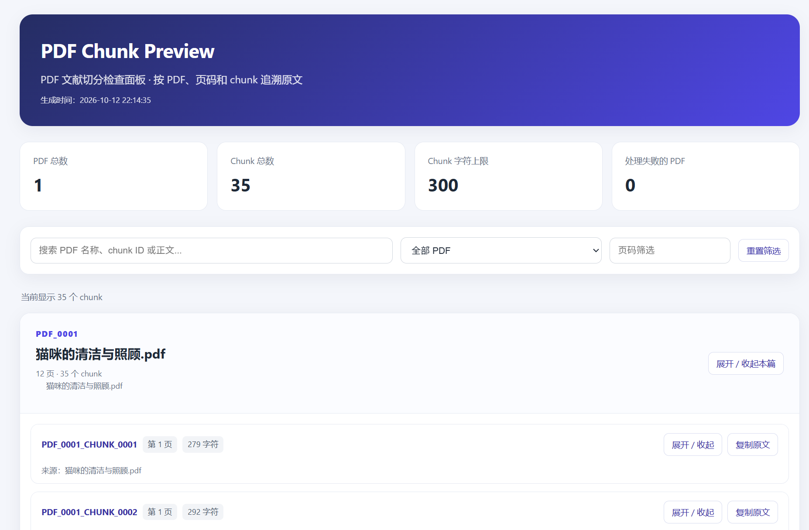

# Chunking Strategy

> <i>A try to cut different context into chunks for preparation for RAG retrieval.</i>

## 1. Overview

In RAG, the chunking strategy is of great importance. This project is an attempt to chunk context and make the result visible ([the chunking result](./output/chunks_preview.html)). The local result is shown below:

 
<i>Fig.1 The local result</i>

## 2. Examples

This project processes a PDF file with contexts of pure words, combined with the project running process. The detailed steps are as follows:

**Step 1: Configure `config.json` according to [config_example.json](./config_example.json)**
 
In `config_example.json`, the paths for working, Python, and other parameters are assigned. This is important for code running in the following steps.

**Step 2: Run [main.py](./main.py)**

***

**Step 3: Remove empty content**
 
Chunking a paper by paragraph is a common method, but it is not valid for abnormal papers, such as soft paragraph chunking. Therefore, this project chunks the paper through punctuation and removes empty content.

**Step 4: Connect different pages and record page numbers**
 
To keep the context continuous, different pages need to be connected. Meanwhile, to know the source of the chunks, the page numbers should be recorded.

**Step 5: Multi-level punctuation chunking**
 
The first level is punctuation for sentence endings, such as `.?!`; the second level is punctuation for clause endings, such as `:;`; the third level is punctuation for short pauses, such as `、`; and the last level is hard chunking of the context. Meanwhile, overlap is set for the connection between chunks.

**Step 6: Page recording**
 
A chunk may come from different pages, and the message for the chunk should include paper ID, chunk ID, pages, the chunk content, and so on.

## 3. License

MIT License.